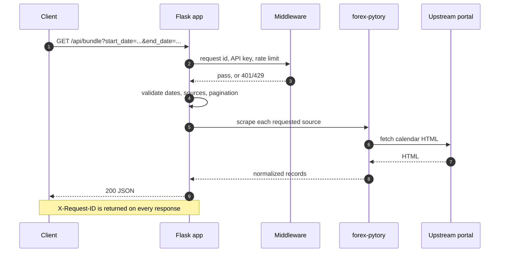

# ForexFactoryScrapper

[](https://github.com/AtaCanYmc/ForexFactoryScrapper/actions)
[](https://atacanymc.github.io/ForexFactoryScrapper/)
[](https://www.python.org/)
[](https://github.com/AtaCanYmc/ForexFactoryScrapper/releases)
[](https://github.com/AtaCanYmc/ForexFactoryScrapper/commits/main)
[](Dockerfile)
[](LICENSE)

ForexFactoryScrapper is a Flask REST API service that aggregates and serves economic calendar events from financial portals including ForexFactory, CryptoCraft, EnergyExch, and MetalsMine.

## Table of Contents

- [Architecture](#architecture)
  - [Request lifecycle](#request-lifecycle)
  - [Repository layout](#repository-layout)
- [Quick Start](#quick-start)
  - [Docker](#docker)
  - [Local Environment](#local-environment)
- [API Reference](#api-reference)
  - [Endpoint Overview](#endpoint-overview)
  - [Authentication and errors](#authentication-and-errors)
  - [Pagination and limits](#pagination-and-limits)
  - [Daily Events Endpoints](#daily-events-endpoints)
  - [Multi-Source Bundle Endpoint](#multi-source-bundle-endpoint)
  - [Sitemap Endpoint](#sitemap-endpoint)
  - [OpenAPI and Swagger UI](#openapi-and-swagger-ui)
- [Configuration](#configuration)
- [Deployment](#deployment)
- [Testing and Verification](#testing-and-verification)
- [Documentation and Developer Commands](#documentation-and-developer-commands)
- [Frequently Asked Questions](#frequently-asked-questions)
- [Roadmap](#roadmap)
- [Contributing](#contributing)
- [Security](#security)
- [License](#license)

## Architecture

All HTML extraction and DOM parsing logic is isolated within the upstream [`forex-pytory`](https://github.com/AtaCanYmc/forex-pytory) package. ForexFactoryScrapper acts exclusively as an HTTP API layer responsible for request validation, pagination, CORS handling, and OpenAPI schema generation.



### Request lifecycle



### Repository layout

```text
.
├── src/
│   ├── app.py                  # Flask app and blueprint registration
│   ├── middleware.py           # request id, API key, headers, access log
│   ├── performance.py          # cache, rate limit, upstream probe
│   ├── metrics.py              # Prometheus collectors and renderer
│   ├── openapi_spec.py         # OpenAPI 3.0.0 document
│   ├── routes/                 # one blueprint per data source and helper
│   └── templates/              # welcome page and Swagger UI
├── tests/                      # pytest suite
├── bruno/                      # Bruno API contract collection
├── pages/                      # GitHub Pages site published by docs.yml
├── docs/assets/                # README banner and architecture graphic
├── deploy/                     # Caddyfile and Helm chart
├── scripts/                    # .env wizard, curl examples, port helper
├── notebook/                   # exploratory notebook
├── postman/                    # legacy Postman collection
├── main.py                     # entry point
├── Dockerfile
├── docker-compose.yml
├── Makefile
└── requirements.txt
```

## Quick Start

### Docker

Build and run the containerized service. Defaults work without a `.env` file.

```bash
# 1. Build the Docker image
docker build -t forexfactory-scrapper .

# 2. Run container in background
docker run -d -p 5000:5000 --name forexfactory-scrapper forexfactory-scrapper

# 3. Verify health status
curl -f http://localhost:5000/api/health
```

### Local Environment

Prerequisites: Python 3.10, 3.11, or 3.12.

```bash
# 1. Create and activate virtual environment
python -m venv .venv
source .venv/bin/activate

# 2. Install dependencies
pip install -r requirements.txt

# 3. Optional: start from the documented defaults
cp .env.example .env

# 4. Start API server
python main.py
```

The application listens on `http://127.0.0.1:5000` by default (or `http://0.0.0.0:5000` inside Docker).

Interactive documentation interfaces:

- Web Welcome Page: `http://localhost:5000/`
- Swagger UI: `http://localhost:5000/swagger`
- OpenAPI Specification: `http://localhost:5000/openapi.json`

Configuration is optional. Every supported variable is listed in [Configuration](#configuration) and in [`.env.example`](.env.example). The interactive wizard writes a `.env` file for you:

```bash
python scripts/init_wizard.py
```

## API Reference

### Endpoint Overview

| Method | Path | Required Parameters | Optional Parameters | Description |
| :--- | :--- | :--- | :--- | :--- |
| `GET` | `/` | None | None | HTML landing page with quick navigation links. |
| `GET` | `/api/hello` | None | None | Basic sanity check endpoint. |
| `GET` | `/api/health` | None | None | Service health check. Add `?probe=true` for upstream latency (ms) and peak memory (MB). |
| `GET` | `/api/forex/daily` | `day`, `month`, `year` | `limit`, `offset` | ForexFactory economic calendar events for a specific day. |
| `GET` | `/api/cryptocraft/daily` | `day`, `month`, `year` | `limit`, `offset` | CryptoCraft calendar events for a specific day. |
| `GET` | `/api/energyexch/daily` | `day`, `month`, `year` | `limit`, `offset` | EnergyExch calendar events for a specific day. |
| `GET` | `/api/metalsmine/daily` | `day`, `month`, `year` | `limit`, `offset` | MetalsMine calendar events for a specific day. |
| `GET` | `/api/bundle` | `start_date`, `end_date` | `sources`, `limit`, `offset` | Aggregated economic events across selected platforms for a date range. |
| `GET` | `/api/forex/sitemaps` | None | `start_date`, `end_date`, `max_pages`, `limit`, `offset` | Paginated sitemap URLs retrieved from ForexFactory. |
| `GET` | `/metrics` | None | None | Prometheus metrics: request count, latency histogram, cache hits, misses and hit ratio, rate-limit rejections. |
| `GET` | `/swagger` | None | None | Swagger UI documentation console. |
| `GET` | `/openapi.json` | None | None | Raw OpenAPI 3.0 schema definition. |

Set `API_KEYS` to require a key on `/api/*`. Send it as `X-API-Key: <key>` or `Authorization: Bearer <key>`. A missing or wrong key returns `401`. `/api/health` and `/metrics` stay open for probes and scrapers, so restrict `/metrics` at the proxy or network layer if it should not be public.

### Authentication and errors

`/api/health` is exempt from both the API key check and the rate limit. `/metrics` is outside `/api/*`, so it is also exempt. Every response includes `X-Request-ID`; an inbound value is reused, otherwise the service generates one.

| Status | Typical body | Notable headers | Cause |
| :---: | :--- | :--- | :--- |
| `401` | `{"error": "Missing or invalid API key"}` | `WWW-Authenticate: Bearer` | `API_KEYS` is set and the request has no valid key. |
| `429` | `{"error": "Rate limit exceeded"}` | `Retry-After` | The client exceeded `RATE_LIMIT_PER_MINUTE`. |
| `400` | `{"error": "Missing required parameters", "message": "..."}` | `X-Request-ID` | Missing or invalid query parameters. |
| `500` | `{"error": "Internal Server Error", "message": "...", "status": "error", "code": 500, "correlation_id": "..."}` | `X-Request-ID` | Unhandled server exception. |

Health responses:

```bash
curl -s http://localhost:5000/api/health
# {"status":"ok"}

curl -s "http://localhost:5000/api/health?probe=true"
# {"status":"ok","upstream":{"reachable":true,"status":200,"latency_ms":84.2},"memory_mb":41.7}
```

`upstream.status` is omitted and `upstream.error` is set when the probe cannot reach the portal. `memory_mb` is the peak resident set size of the process.

### Pagination and limits

- `limit` accepts 0 to 500; `offset` accepts 0 to 100000. Larger values return `400`.
- `/api/bundle` date ranges are capped by `MAX_BUNDLE_DAYS`, default 31.
- `/api/forex/sitemaps` accepts `max_pages` from 1 to `MAX_SITEMAP_PAGES`, default 100. The route default is 10.

### Daily Events Endpoints

Available routes:

- `/api/forex/daily`
- `/api/cryptocraft/daily`
- `/api/energyexch/daily`
- `/api/metalsmine/daily`

#### Query Parameters

| Parameter | Type | Required | Description |
| :--- | :--- | :---: | :--- |
| `day` | Integer | Yes | Calendar day of month (1-31). |
| `month` | Integer | Yes | Calendar month (1-12). |
| `year` | Integer | Yes | Four-digit calendar year. |
| `limit` | Integer | No | Maximum number of records to return. Must be non-negative. |
| `offset` | Integer | No | Number of records to skip for pagination. Must be non-negative. |

#### Response Schema

```json
{
  "total": 14,
  "offset": 0,
  "limit": 10,
  "results": [
    {
      "id": "138542",
      "date": "2026-05-20",
      "time": "8:30am",
      "currency": "USD",
      "impact": "High",
      "event": "CPI m/m",
      "actual": "0.3%",
      "forecast": "0.2%",
      "previous": "0.4%"
    }
  ]
}
```

### Multi-Source Bundle Endpoint

Path: `GET /api/bundle`

Retrieves events from multiple calendar providers over a continuous date range.

#### Query Parameters

| Parameter | Type | Default | Description |
| :--- | :--- | :--- | :--- |
| `start_date` | String (`YYYY-MM-DD`) | Required | Start date of query range (inclusive). |
| `end_date` | String (`YYYY-MM-DD`) | Required | End date of query range (inclusive). |
| `sources` | Comma-separated string | `forex` | Target sources to scrape: `forex`, `crypto`, `metal`, `energy`. |
| `limit` | Integer | None | Maximum total records to return. |
| `offset` | Integer | `0` | Number of records to skip across aggregated results. |

#### Example Request

```bash
curl "http://localhost:5000/api/bundle?sources=forex,crypto&start_date=2026-05-20&end_date=2026-05-21&limit=25"
```

#### Response Structure

```json
{
  "total": 28,
  "offset": 0,
  "limit": 25,
  "start_date": "2026-05-20",
  "end_date": "2026-05-21",
  "sources": ["forex", "crypto"],
  "source_breakdown": {
    "forex": 18,
    "crypto": 10
  },
  "results": [
    {
      "_source": "forex",
      "_date": "2026-05-20",
      "id": "138542",
      "currency": "USD",
      "event": "CPI m/m"
    }
  ]
}
```

### Sitemap Endpoint

Path: `GET /api/forex/sitemaps`

Traverses the ForexFactory sitemap index and child sitemaps to locate indexed historical URLs.

#### Query Parameters

| Parameter | Type | Default | Description |
| :--- | :--- | :--- | :--- |
| `start_date` | String (`YYYY-MM-DD`) | None | Filter sitemaps with `lastmod` on or after this date. |
| `end_date` | String (`YYYY-MM-DD`) | None | Filter sitemaps with `lastmod` on or before this date. |
| `max_pages` | Integer | `10` | Maximum child sitemaps to parse. Must be positive integer. |
| `limit` | Integer | None | Pagination size for URL list. |
| `offset` | Integer | `0` | Pagination offset. |

### OpenAPI and Swagger UI

The API specification is defined in `src/openapi_spec.py` and served as OpenAPI 3.0.0.

- Swagger UI is accessible at `/swagger`.
- Machine-readable schema is served at `/openapi.json`.

When modifying endpoints, keep `src/openapi_spec.py` synchronized with route implementations. The `info.version` field is advanced by Release Please.

## Configuration

The service reads configuration from environment variables or a local `.env` file via `python-dotenv`. The complete template is [`.env.example`](.env.example); copy it to `.env` and edit. Missing values fall back to the defaults below. Some limits are read per request, while `DOTENV_PATH` is applied at startup.

| Variable | Type | Default | Required | Description |
| :--- | :--- | :--- | :---: | :--- |
| `HOST` | String | `127.0.0.1` | No | Network interface to bind the Flask server (`0.0.0.0` in Docker). |
| `PORT` | Integer | `5000` | No | Port number to accept incoming connections. |
| `DEBUG` | Boolean | `False` | No | Enable Flask debug reloader and error tracebacks. |
| `CORS_ORIGINS` | Comma-separated | `*` | No | Allowed CORS origin URLs. |
| `MAX_BUNDLE_DAYS` | Integer | `31` | No | Maximum allowed date span for the multi-source bundle endpoint. |
| `MAX_SITEMAP_PAGES` | Integer | `100` | No | Upper bound for the sitemaps `max_pages` parameter. |
| `CACHE_TTL_SECONDS` | Integer | `0` | No | TTL for cached upstream responses. `0` disables caching. The backend is selected by `CACHE_BACKEND`. |
| `CACHE_MAX_ENTRIES` | Integer | `256` | No | Maximum entries in the memory cache. Ignored by the Redis backend. |
| `CACHE_BACKEND` | String | `memory` | No | `memory` is per process. `redis` shares the cache across replicas and needs `REDIS_URL`. Redis failures fall back to live upstream fetches. |
| `REDIS_URL` | String | `redis://localhost:6379/0` | No | Redis connection URL, used when `CACHE_BACKEND=redis`. |
| `API_KEYS` | String | empty | No | Comma-separated keys. When set, `/api/*` requires `X-API-Key: <key>` or `Authorization: Bearer <key>`. `/api/health` and `/metrics` stay open. |
| `RATE_LIMIT_PER_MINUTE` | Integer | `0` | No | Per-client request cap on `/api/*` (excluding `/api/health`). Exceeding it returns `429` with `Retry-After`. `0` disables. |
| `LOG_FORMAT` | String | `text` | No | `json` emits one JSON object per line, including a per-request access log. |
| `LOG_LEVEL` | String | `INFO` | No | Python logging level. |
| `TRUST_PROXY_HOPS` | Integer | `0` | No | Trusted reverse-proxy hops. Set `1` behind Caddy or an ingress so rate limiting sees the real client IP. |
| `DOTENV_PATH` | String (Path) | None | No | Explicit file path to load environment variables from. |

## Deployment

### Docker Compose with TLS

`docker-compose.yml` runs the app behind a Caddy reverse proxy that terminates TLS. Caddy obtains and renews Let's Encrypt certificates for a public `DOMAIN`, and uses an internal certificate for `localhost`. Ports 80 and 443 must reach the host.

```bash
DOMAIN=api.example.com docker compose up -d
curl -f https://api.example.com/api/health
```

The compose file passes only the variables listed in its `app.environment` block. Add `API_KEYS` there when the proxied service must require keys.

### Kubernetes (Helm)

The chart in `deploy/helm/forexfactory-scrapper` deploys the service with health probes, a non-root read-only container, and an optional Ingress.

```bash
helm install ffs deploy/helm/forexfactory-scrapper \
  --set image.repository=<your-registry>/forexfactory-scrapper \
  --set ingress.enabled=true --set ingress.host=api.example.com --set ingress.tls.enabled=true
```

Chart values for `env`, `trustProxyHops`, `resources`, and `ingress` are documented in `values.yaml`. When `image.tag` is empty, the chart uses `Chart.appVersion`.

## Testing and Verification

Run the full local gate before opening a pull request:

```bash
make install-dev
make check
```

`make check` runs flake8, `black --check`, bandit, and pytest. Tests live under `tests/`: `test_app.py` covers routes, `test_security.py` covers headers, input validation, and defaults, and `test_init_wizard.py` covers the environment wizard. External network calls are monkeypatched.

CI runs the same checks on Python 3.10, 3.11, and 3.12. It also lints and renders the Helm chart and runs the offline Bruno contract requests against a live local API.

## Documentation and Developer Commands

The public documentation site is the static `pages/` directory, published by `.github/workflows/docs.yml` to `https://atacanymc.github.io/ForexFactoryScrapper/`. It contains the landing page, the interactive request sandbox, `llms.txt`, `robots.txt`, and the sitemap.

A [Bruno](https://www.usebruno.com/) collection lives in `bruno/`. Open the folder in Bruno and select the `local` environment, or install the CLI and run the requests:

```bash
npm install -g @usebruno/cli
cd bruno
bru run --env local
```

Start the API first. Daily, bundle, sitemap, and probe requests need outbound network access; the remaining requests run against the local API.

A `Makefile` wraps the common local commands:

| Command | Description |
| :--- | :--- |
| `make venv` | Create `.venv`. |
| `make init` | Interactive wizard that writes `.env` (`python scripts/init_wizard.py --defaults` for no prompts). |
| `make install` | Install runtime and test dependencies. |
| `make install-dev` | Install black, flake8, and bandit. |
| `make run` | Start the API server locally. |
| `make test` | Run the pytest suite. |
| `make lint` | Run flake8 and `black --check`. |
| `make format` | Auto-format with black. |
| `make security` | Run the bandit scan used in CI. |
| `make check` | Run lint, security, and tests (mirrors CI). |
| `make docker-build` | Build the container image. |
| `make docker-run` | Run the container in the background. |
| `make docker-stop` | Stop and remove the container. |
| `make docker-logs` | Follow container logs. |
| `make clean` | Remove caches and temporary artifacts. |

## Frequently Asked Questions

### Why is the scraping engine separated into forex-pytory?

Separating the scraper into `forex-pytory` establishes distinct boundaries between HTTP presentation and HTML parsing. If target sites modify their HTML DOM, parser updates occur exclusively in `forex-pytory` without requiring redeployment or changes to the API routing layer.

### Does this service cache calendar responses?

The API has no database. By default every request triggers a live upstream fetch through `forex-pytory`. Set `CACHE_TTL_SECONDS` to reuse upstream responses. `CACHE_BACKEND=memory` caches per process; `CACHE_BACKEND=redis` shares the cache across replicas. Set `RATE_LIMIT_PER_MINUTE` to cap each client so upstream portals do not block the service IP.

### How are invalid dates or parameters handled?

Parameters are validated before invoking upstream scrapers. Malformed dates, non-integer date components, or negative pagination limits return HTTP 400 before any upstream call. The body is JSON, for example `{"error": "Missing required parameters", "message": "..."}`.

## Roadmap

Active development targets, release schedules, and upcoming features are tracked in [ROADMAP.md](ROADMAP.md).

## Contributing

Review development practices, branch naming conventions, and pull request requirements in [CONTRIBUTING.md](CONTRIBUTING.md).

## Security

To report security vulnerabilities privately, follow the instructions in [SECURITY.md](SECURITY.md).

## License

This project is licensed under the terms of the [MIT License](LICENSE).
Copyright (c) 2026 Ata Can Yaymacı.
